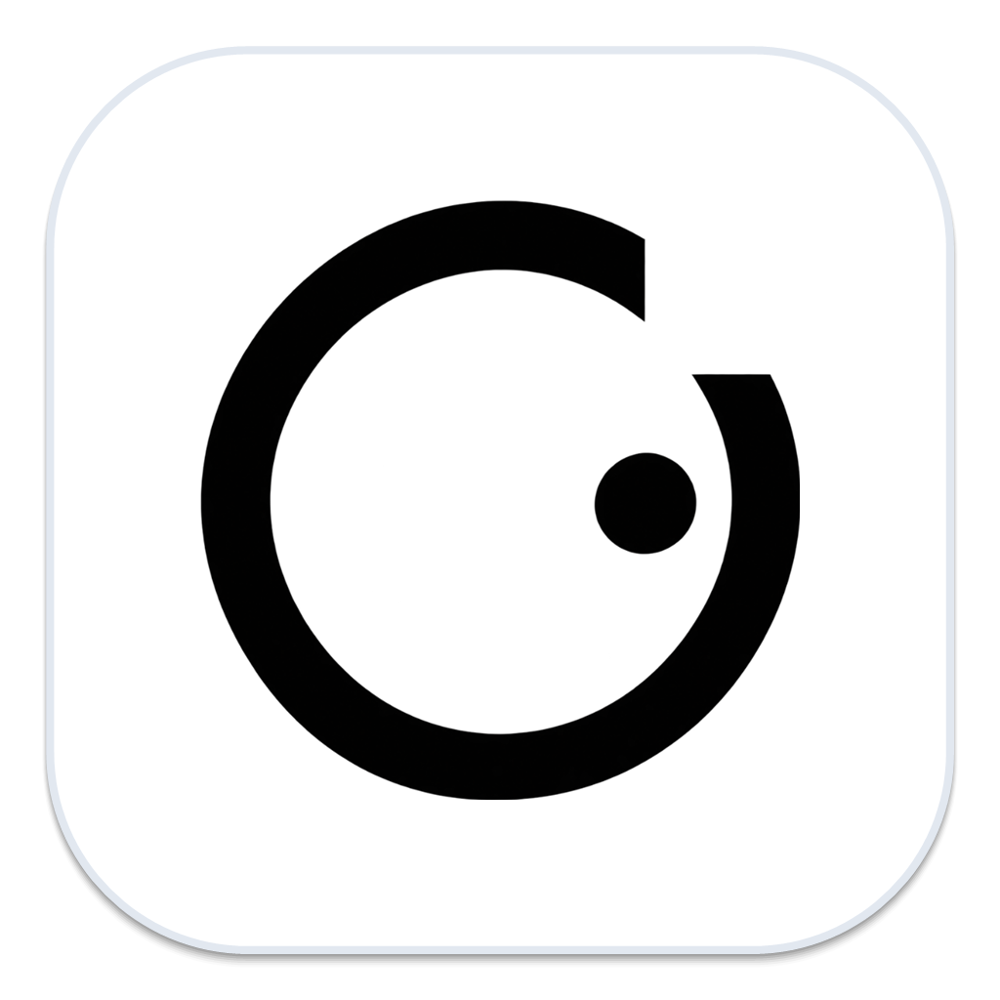

# NOVA Clip

<p align="center">
  
</p>

<p align="center">
  <strong>Everything you copy. Always within reach.</strong><br>
  <em>Production-Grade Windows Clipboard Manager with Instant Phone-to-PC Sync & Dynamic Island Dock</em>
</p>

<p align="center">
  
  
  
  
  
  
  
</p>

---

## ⚡ What is NOVA Clip?

**NOVA Clip** is a modern, privacy-first clipboard manager built in C# and .NET 10 for Windows 10 and 11. It reimagines clipboard productivity with two flagship capabilities:

1. **A Floating Top Island Dock** positioned horizontally at the top center of your screen with instant 1-click copy and native drag-and-drop.
2. **Instant Local Phone-to-PC Sync** that allows you to copy links, text, and files from your iPhone, Android, or tablet directly into your PC's clipboard over your local Wi-Fi with **zero cloud servers, zero accounts, and zero telemetry**.

Every item stored on disk is encrypted using native **Windows DPAPI** (`CurrentUser` scope) inside a high-speed SQLite database running in WAL mode.

---

## ✨ Key Features

### 1. 🏝️ Floating Top Island Dock (Quick Access Bar)
- **Top-Center Minimalist Dock**: Floats right below your webcam/top screen edge covering ~40% width. Kept intentionally sleek, horizontal, and distraction-free.
- **4 Real-Time Clip Slots**: Each slot dynamically shows your most recent copied items with color-coded type badges:
  - 📝 **TEXT** (Blue)
  - 🔗 **LINK** (Cyan)
  - 📁 **FILE** (Emerald Green)
  - 🖼️ **IMG** (Purple)
- **1-Click Copy**: Click any slot to immediately load it back into your system clipboard (shows green `COPIED` confirmation).
- **Native OLE Drag-and-Drop**: Drag directly from any island slot into Word, Notepad, VS Code, Discord, browsers, or Windows File Explorer.
- **Global Hotkey**: Press <kbd>Ctrl</kbd> + <kbd>Shift</kbd> + <kbd>Space</kbd> anywhere in Windows to toggle the island in/out of view.
- **Phone Sync Pill**: Shows your phone sync URL right in the dock for one-click access.

---

### 2. 📱 Two-Way Phone ⇄ PC Local Sync (Cross-Device Clipboard)
Seamlessly sync links, text snippets, and files in **both directions** between your iPhone/Android device and your Windows PC in real time!
- **Two-Way Clipboard Sharing**:
  - **PC ➔ iPhone**: Anything copied on your PC or clicked on the Top Island dock is immediately sent to your phone. Open the web interface on your phone to see latest PC clips and 1-tap copy directly into iOS clipboard or open links in Safari.
  - **iPhone ➔ PC**: Type or paste on your mobile browser, tap **Send to PC**, and it is instantly injected into your Windows system clipboard (`Ctrl+V` ready) and Top Island dock.
  - **Context Menu Actions**: Right-click any slot on your PC Top Island dock and click **📱 Send to iPhone** to push any specific clip on demand.
- **Modern Apple-Style Light Theme**: Mobile web interface is designed with a clean, native iOS light theme by default (`#F8FAFC`, crisp typography, and touch-optimized buttons).
- **Zero Cloud & Zero Internet Dependency**: Runs a high-performance local TCP HTTP server directly on your PC. Traffic never leaves your local Wi-Fi router.
- **Works with Any Mobile Browser**: No mobile app installation required. Simply open the local URL in Safari or Chrome on your phone.
- **Instant System Injection**: As soon as you tap **Send to PC** on your phone, the content is:
  1. Ingested into your encrypted database
  2. Injected directly into the Windows system clipboard (`Ctrl+V` ready)
  3. Placed immediately into Slot 1 of your Top Island Bar
  4. Confirmed with a desktop toast notification
- **File Upload Support**: Send photos, PDFs, or documents from your phone straight to your PC's Downloads folder.

---

### 3. 📋 Comprehensive Clipboard Management Suite
- **Complete Clipboard History**: Infinite or bounded storage (up to 500 items, customizable retention).
- **Full Management Dashboard**: Press the brand logo on the island to open the rich Windows desktop dashboard.
- **Live Search & Filter Chips**: Filter instantly by `All`, `Starred`, `Text`, `Links`, `Images`, and `Files`.
- **Favorites & Starred Clips**: Pin crucial snippets, code blocks, URLs, and templates forever.
- **Multi-Item Paste Queue**:
  - Queue up multiple items to paste sequentially across spreadsheets, forms, or documents.
  - <kbd>Ctrl</kbd> + <kbd>Alt</kbd> + <kbd>C</kbd> — Copy Next item in queue.
  - <kbd>Ctrl</kbd> + <kbd>Alt</kbd> + <kbd>V</kbd> — Auto-switch back to target app, inject keystrokes via Windows `SendInput`, and advance queue.

---

### 4. 🛡️ Enterprise-Grade Privacy & Security
- **100% Local & Encrypted at Rest**: All payloads (text, HTML, RTF, images, paths) are encrypted on disk via **Windows DPAPI** (`ProtectedData.Protect` with `DataProtectionScope.CurrentUser`). Even if someone steals your `.db` file, they cannot read your clipboard history.
- **Smart Sensitive Data Filter**: Automatically detects and skips capturing sensitive data:
  - Credit Card numbers (validated via the Luhn algorithm)
  - One-Time Passwords (OTPs) and 2FA tokens
  - API Keys, private keys, and passwords
- **Process Blacklist**: Automatically blocks capture from password managers (1Password, Bitwarden, KeePass, KeePassXC, LastPass, Dashlane).
- **Zero Telemetry**: No tracking, no analytics, no background external network requests.

---

## ⌨️ Keyboard Shortcuts

| Shortcut | Action | Scope |
| :--- | :--- | :--- |
| <kbd>Ctrl</kbd> + <kbd>Shift</kbd> + <kbd>Space</kbd> | **Toggle Top Island Dock** | Global (System-Wide) |
| <kbd>Ctrl</kbd> + <kbd>Alt</kbd> + <kbd>C</kbd> | **Copy Next** item in Paste Queue | Global (System-Wide) |
| <kbd>Ctrl</kbd> + <kbd>Alt</kbd> + <kbd>V</kbd> | **Paste Next** item into active target window | Global (System-Wide) |
| <kbd>Esc</kbd> | Dismiss Island Dock | When Dock is active |

*All global shortcuts can be customized in Settings.*

---

## 🚀 Installation Guide

### Option 1: Windows Installer (Recommended)
1. Download **`NOVA-Clip-Setup.exe`** from the [Latest Release](https://github.com/patilomkar7570/NOVA-Clip/releases/latest).
2. Run the installer. No administrator rights required (installs to `%LOCALAPPDATA%\Programs\NOVA Clip`).
3. Select whether to enable **Start with Windows** and **Desktop Shortcut**.
4. Click **Finish** — NOVA Clip starts minimized in your system tray and starts the Phone Sync server automatically.

### Option 2: Portable Edition (Zero Installation)
1. Download **`NOVA-Clip-Portable.zip`** from the [Latest Release](https://github.com/patilomkar7570/NOVA-Clip/releases/latest).
2. Extract the ZIP archive anywhere on your PC.
3. Double-click `NOVA.Clip.App.exe` to run. All data is kept isolated in `%LOCALAPPDATA%\NOVA.Clip`.

### Option 3: Build from Source
**Prerequisites**:
- Windows 10 (1809+) or Windows 11 (x64)
- [.NET 10 SDK](https://dotnet.microsoft.com/download/dotnet/10.0)

```powershell
# 1. Clone repository
git clone https://github.com/patilomkar7570/NOVA-Clip.git
cd NOVA-Clip

# 2. Build Release configuration
dotnet build -c Release

# 3. Run automated tests (44 unit tests)
dotnet test -c Release --no-build

# 4. Publish self-contained executable
dotnet publish src/NOVA.Clip.App/NOVA.Clip.App.csproj -c Release -r win-x64 --self-contained true -p:PublishSingleFile=false -o publish/win-x64

# 5. Launch
./publish/win-x64/NOVA.Clip.App.exe
```

---

## 📖 How to Use NOVA Clip

### 1. Using the Top Island Dock
1. Press <kbd>Ctrl</kbd> + <kbd>Shift</kbd> + <kbd>Space</kbd> anytime.
2. The sleek dock appears centered right under your webcam at the top of your screen.
3. **To copy**: Click any of the 4 boxes. The item is loaded into your clipboard and the box turns green (`COPIED`).
4. **To drag-and-drop**: Click and hold any slot, then drag it straight into a document, chat window, or folder.
5. Click the logo button on the left to expand into the full management dashboard.

### 2. Using Phone-to-PC Sync (From iPhone / Android)
1. Make sure your phone and your Windows PC are connected to the **same Wi-Fi network**.
2. Click the blue **📱 Phone Sync** button on the Top Island dock, or check the URL shown (e.g., `http://192.168.x.x:5892`).
3. On your phone (Safari on iOS or Chrome on Android), open the URL:
   ```
   http://<YOUR-PC-IP>:5892
   ```
4. **Send Text / Links**: Paste any link or text in the text area and tap **Send to PC**. It immediately copies to your PC's clipboard!
5. **Send Files**: Tap **Choose File** and tap **Upload to PC**. The file is saved directly to your PC.

> **Pro Tip**: In Safari on your iPhone, tap the **Share** button → **"Add to Home Screen"**. It will appear like a native app on your phone for 1-tap clipboard sharing!

### 3. Using the Sequential Paste Queue
1. Open the Full Dashboard and navigate to **Paste Queue**.
2. Add multiple items in the order you need them pasted.
3. Switch to your destination program (e.g., Excel or web form).
4. Press <kbd>Ctrl</kbd> + <kbd>Alt</kbd> + <kbd>V</kbd> repeatedly to paste each item one by one without alt-tabbing!

---

## 🛠️ Configuration & Settings

NOVA Clip stores user preferences in `%LOCALAPPDATA%\NOVA.Clip\settings.json`.

- **Auto-Startup on Boot**: NOVA Clip automatically launches minimized in the background on Windows boot so Phone Sync is always ready. You can toggle this in Settings → General.
- **Theme Modes**: Supports **Light Mode** (default) and **Dark Mode** with high-contrast type badges.
- **Excluded Processes**: Configure sensitive applications (password managers, banking apps) to never capture clipboard data.
- **Custom Hotkeys**: Rebind all shortcuts in Settings → Activation.

---

## 🏗️ Project Architecture

```
NOVA-Clip/
├── src/
│   ├── NOVA.Clip.Core/            # Domain models, interfaces, configuration, enums
│   ├── NOVA.Clip.Infrastructure/  # Win32 APIs, SQLite (WAL), DPAPI, Network Sync Server
│   ├── NOVA.Clip.App/             # WPF Views, MVVM CommunityToolkit ViewModels, Themes
│   └── NOVA.Clip.Tests/           # Comprehensive xUnit test suite (44 tests)
├── installer/                     # Inno Setup 6 compilation script (NovaClip.iss)
├── assets/                        # Icons, application logos, and installer graphics
├── scripts/                       # Automated build, publish, and packaging scripts
└── dist/                          # Packaged installer and portable ZIP releases
```

---

## 🧪 Test Suite

NOVA Clip comes with a comprehensive automated test suite covering:
- DPAPI encryption roundtrip & payload integrity
- Heuristic privacy filter (credit cards Luhn verification, API keys, password manager checks)
- Clipboard service ingestion & duplicate suppression
- Sequential paste queue advancement & fallback logic
- Phone sync payload deserialization & file safety

Run tests with:
```powershell
dotnet test -c Release
```

---

## 📄 License

Distributed under the **MIT License**. See [LICENSE](LICENSE) for details.

---

<p align="center">
  Crafted with care for Windows power users.
</p>
